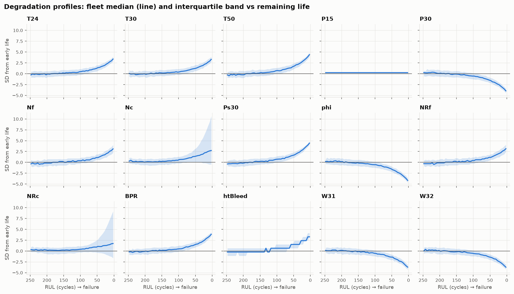

# Turbofan Engine Degradation: Data Analysis and Feature Engineering (NASA C-MAPSS FD001)

Internship assessment, Task 2: data understanding, cleaning, outlier analysis, EDA, feature engineering and selection, scaling, and leakage control on a real prognostics dataset. The deliverable is an ML-ready dataset and the reasoning behind it. No predictive model is trained here; that belongs to a later stage.

The full analysis is in [`notebooks/task2_analysis.ipynb`](notebooks/task2_analysis.ipynb). Each section states what is done and why, shows the result, and ends with a decision.

### Video walkthroughs

| Video | Length | What it covers |
|---|---|---|
| [1. Data understanding and core concepts](https://github.com/Adityabairagi21/cmapss-predictive-maintenance/releases/download/v1.0/01_data_understanding_and_concepts.mp4) | 6:42 | What C-MAPSS is, how the train / test / RUL files fit together, and the key ideas (RUL, degradation, leakage) |
| [2. Project flow and code walkthrough](https://github.com/Adityabairagi21/cmapss-predictive-maintenance/releases/download/v1.0/02_project_flow_and_code_walkthrough.mp4) | 20:41 | The notebook end to end: ingestion, cleaning, EDA, feature engineering, selection, scaling and QA |

Both videos are attached to the [v1.0 release](https://github.com/Adityabairagi21/cmapss-predictive-maintenance/releases/tag/v1.0).

---

## 1. Executive summary

- The FD001 training set (100 engines, 20,631 cycles, 21 sensors) is structurally clean: no missing values, duplicates, gaps or invalid readings. Seven columns are constant and were dropped.
- 11.8% of rows fall outside 1.5 × IQR fences. These are not errors: 61% of them sit in the final 10% of engine life, and every sensor's outliers point in its degradation direction. No rows were removed.
- The degradation signal is shared across engines, non-linear (flat, then accelerating), and visible about 120–160 cycles before failure. Single readings are dominated by noise.
- 57 temporal features were built per engine, using only past and current cycles. Automated tests confirm they use no future information and no information from other engines.
- Mutual information, redundancy clustering, domain reasoning and an engine-grouped CV diagnostic reduce 75 candidates to 17 features. In the diagnostic, they halve the error relative to raw sensors (RMSE 16.7 → 9.0).
- A random row-level split would have reported RMSE 5.2 instead of 9.0, an optimism of 42%. All validation here is grouped by engine.
- The recommended target is `RUL_capped = min(RUL, 125)`; the uncapped RUL is kept as well. 51 of 51 automated QA checks pass on the saved files.

## 2. Motivation

Aircraft engines degrade gradually. Fixed-interval maintenance replaces parts that still have useful life left, and run-to-failure maintenance accepts failures in service. Predictive maintenance estimates each engine's **Remaining Useful Life (RUL)** from its sensor history, so maintenance can be scheduled shortly before it is needed. The quality of such a model depends on the data preparation: noisy sensors, uninformative channels, and very easy ways to leak future information into features.

## 3. Dataset

**Source:** NASA Prognostics Center of Excellence, *Turbofan Engine Degradation Simulation Data Set* (C-MAPSS), file `CMAPSSData.zip` from the NASA Open Data Portal.
Reference: A. Saxena, K. Goebel, D. Simon, N. Eklund, *"Damage Propagation Modeling for Aircraft Engine Run-to-Failure Simulation"*, Proc. 1st Int. Conf. on Prognostics and Health Management (PHM08), Denver, 2008.

FD001 is one of four subsets: one operating condition (sea level) and one fault mode (high-pressure compressor degradation).

| File | Contents |
|---|---|
| `train_FD001.txt` | 100 engines, each recorded until failure (20,631 rows) |
| `test_FD001.txt` | 100 engines, each stopped before failure (13,096 rows) |
| `RUL_FD001.txt` | True remaining life of each test engine after its last recorded cycle |

## 4. Data structure

There are 26 space-separated numeric columns: engine ID, cycle, 3 operational settings and 21 sensors. The sensor names and units (e.g. `T30` HPC outlet temperature, `Ps30` HPC static pressure, `phi` fuel flow / Ps30) come from Table 2 of the paper. The readme numbers the sensors only.

Two documentation issues found while parsing:
- The readme lists columns up to "sensor measurement 26"; there are 21.
- Every line has trailing spaces, which would create phantom empty columns under naive parsing.

The column-to-sensor mapping follows the order of the paper's table. This is the standard interpretation, supported by the data (the fan-inlet temperature column is constant at 518.67 °R, the ISA sea-level temperature), but it is recorded as an assumption. The full data dictionary is in `outputs/data_dictionary.csv`.

## 5. Problem definition

- **Training target:** `RUL = engine's last cycle − current cycle`. Every training engine ends at RUL 0.
- **Test target:** `RUL = (last observed cycle + value from RUL_FD001.txt) − current cycle`.
- **Unit of analysis:** one engine-cycle. **Grouping entity:** the engine. Rows from one engine must never be split between training and validation.

## 6. Data-quality findings

| Check | Result | Action |
|---|---|---|
| Missing values | None | No imputation performed |
| Duplicate rows / duplicate (engine, cycle) | None | No de-duplication performed |
| Cycle gaps, ordering, invalid or non-positive values | None | None |
| Constant columns | `op_setting_3`, `T2`, `P2`, `epr`, `farB`, `Nf_dmd`, `PCNfR_dmd` | Dropped (identified on train, applied to both splits) |
| Near-zero variance | `P15` (two values) | Kept for selection; later removed (no information) |
| Engine lifetimes | 128–362 cycles; 4 long-lived engines | Kept: natural variation, not errors |

## 7. Preprocessing decisions

1. **Outliers kept.** IQR flags concentrate at end of life (70% of rows in the final life decile) and agree with each sensor's wear direction. A separate spike screen against each engine's own neighbouring cycles found no physically impossible or contradicted readings. Removing or clipping would delete the degradation signal.
2. **No operating-condition normalisation.** The two varying settings form a single cloud, behave like white noise, and explain at most 0.04% of any sensor's variance.
3. **No encoding.** There are no categorical variables. `unit_id` is an identifier and is deliberately not one-hot encoded, since that would let a model memorise engines.
4. **Scaling.** `StandardScaler`, fitted on training engines only and applied unchanged to test. The tails are kept because they are real.

## 8. EDA findings

- Twelve sensors trend in the same direction in all 100 engines. `Ps30`, `phi`, `T50` and `P30` are the most strongly monotonic (within-engine |ρ| ≈ 0.77–0.82).
- Aligned at failure, engines share one degradation shape, but each starts from a different healthy level (initial wear).
- `Nc` and `NRc` are engine-dependent: their direction flips in 29–40% of engines, so they look weak in pooled correlations.
- `P15` never changes in 38 of 100 engines.
- Over a whole lifetime, the best sensors drift only 6–7× their cycle-to-cycle noise, so the signal has to be accumulated over several cycles.
- A composite of the consistent sensors stays at baseline until about RUL 160, then rises steadily (0.6 SD at RUL 80–100, 3.2 SD in the last 20 cycles).



## 9. Feature engineering

Every feature is computed within one engine, from the current and earlier cycles only.

| Family | Definition | Purpose |
|---|---|---|
| Rolling mean | trailing 10 cycles | Reduce noise (≈ √10) |
| EWM | span 10 | Noise reduction that responds faster |
| Rolling slope | trailing 20 cycles, ≥ 10 required | Rate of degradation |
| Delta from baseline | EWM − the engine's own first-10-cycle mean | Remove each engine's initial-wear offset |
| Health index | mean wear-aligned delta of 12 sensors (parameters fitted on train) | One low-noise wear indicator |

Lag, first-difference, percentage-change, rolling min/max/std and expanding-mean features were screened and rejected, with evidence (e.g. first differences correlate |ρ| ≈ 0.02 with RUL: pure noise).

One issue was caught during review: the first version of the slope, fitted from 2 cycles onwards, produced large spurious values at the start of each engine. It now needs at least 10 readings.

## 10. Feature selection

Starting from 75 candidates (57 engineered + 15 raw sensors + 2 settings + cycle):

1. Remove features with no information (MI < 0.02): both settings, `P15`.
2. Remove redundant families: EWM ≈ rolling mean (ρ = 0.996); raw ≈ noisier rolling mean; slopes add nothing in the grouped diagnostic.
3. Keep one sensor from each physical-duplicate pair (`Nf` over `NRf`, `NRc` over `Nc`).
4. Cluster at |ρ| > 0.9 and keep the most informative member. Ten smoothed levels collapse to `Ps30_mean10`.

**Final 17 features:** `health_index`; deltas of `T24`, `T30`, `T50`, `P30`, `Nf`, `Ps30`, `phi`, `NRc`, `BPR`, `htBleed`, `W31`, `W32`; `Ps30_mean10`, `Nf_mean10`, `NRc_mean10`; `cycle`.

Mutual information mattered: `NRc_delta` has |ρ| = 0.20 with RUL but MI = 0.51. Its drift grows towards failure in either direction depending on the engine, which a correlation-only selection would have missed. The selection is stable across five MI random seeds. Every removed feature and its reason is in `outputs/feature_selection_summary.csv`.

| Feature set (engine-grouped 5-fold CV, capped RUL) | RMSE |
|---|---|
| Raw sensors + settings + cycle | 16.7 |
| All 75 candidates | 8.8 |
| **Final 17 features** | **9.0** |
| Final 17 without `cycle` | 13.5 |
| Final 17, linear model | 16.8 |

This is a diagnostic for comparing feature sets, scored on all cycles. It is not comparable with published FD001 test scores, and it is slightly optimistic because selection used the same training engines.

## 11. Leakage prevention

| Risk | Control | Verified by |
|---|---|---|
| Future information in features | Trailing windows only | Truncation and ×1000 future-perturbation tests, train and test |
| Cross-engine contamination | All operations grouped by engine | Per-engine rebuild is identical to the grouped result |
| Target leakage | RUL and lifetime-derived columns excluded from every feature list | Assertions; truncation test rules out indirect encoding |
| Preprocessing fitted on test | All 7 fitted steps learned from train only | Parameters re-derived from train match exactly |
| Random row splits | Engine-grouped CV; `cv_fold` assigns whole engines | Random split understates error by 42% |

The test labels were used only to verify the test RUL construction.

## 12. Final dataset

| File (in `data/processed/`, regenerated by the notebook) | Rows × columns |
|---|---|
| `train_FD001_features.csv`: `unit_id`, 17 features, `RUL`, `RUL_capped`, `cv_fold` | 20,631 × 21 |
| `test_FD001_features.csv`: same features and targets, plus `is_last_cycle` | 13,096 × 21 |
| `train_FD001_scaled.csv`, `test_FD001_scaled.csv`: standardised features, `cycle_raw` kept | same rows |

**Target:** `RUL_capped = min(RUL, 125)` is recommended. The sensors cannot distinguish RUL 300 from 200, and 125 lies within the 120–160 range where degradation becomes visible. The uncapped `RUL` is included so the cap can be treated as a modelling hyperparameter.

Supporting outputs in `outputs/`: `feature_summary.csv`, `scaler_parameters.csv`, `preprocessing_summary.csv`, `data_quality_report.csv`, `data_dictionary.csv`, `feature_selection_summary.csv` and 16 figures.

## 13. Key insights

1. In this dataset, statistical outliers are the signal. Outlier removal driven by IQR would have deleted much of the late-life data, which is where a RUL model most needs to be accurate.
2. Each engine's own history matters. Drift from the engine's own baseline (median |ρ| 0.78) beats absolute smoothed levels (0.74).
3. Correlation is not enough. The core-speed features look weak by correlation but carry substantial non-linear information.
4. How you split decides how good the results look. Rows of the same engine are near-duplicates once rolling features exist, so only engine-level validation is honest.

## 14. Limitations

- FD001 is simulated, with one operating condition and one fault mode. The conclusions about operating conditions and sensor usefulness do not transfer automatically to FD002–FD004 or to real fleets.
- RUL = 0 at the last training cycle assumes failure immediately after the final record.
- Window lengths (10/20 cycles) and the RUL cap (125) are evidence-based defaults, not tuned values.
- Selection and the CV diagnostic used the same training engines, so the diagnostic score is mildly optimistic. The test set has not been used for any evaluation.
- Pooled statistics give long-lived engines more weight (up to 362 rows vs 128).

## 15. Future work

- Tune the windows and the cap inside engine-grouped CV during modelling.
- Evaluate on the test set once, scoring each engine's last cycle, as in the standard benchmark.
- Extend to FD002/FD004, where per-condition normalisation becomes necessary.
- Compare against sequence models that learn temporal features directly.

## 16. How to reproduce

```bash
# 1. Download CMAPSSData.zip (NASA Open Data Portal, "CMAPSS Jet Engine Simulated Data")
#    and extract train_FD001.txt, test_FD001.txt, RUL_FD001.txt and readme.txt into data/raw/

# 2. Create an environment (Python 3.12)
python -m venv .venv
.venv\Scripts\activate          # Windows  (macOS/Linux: source .venv/bin/activate)
pip install -r requirements.txt

# 3. Open notebooks/task2_analysis.ipynb in VS Code or Jupyter, select the .venv kernel, Run All
```

The notebook rebuilds everything from the raw files: processed data, CSV reports and figures. A full run takes about 2–3 minutes on a laptop. Raw and processed data are git-ignored; only code, reports and figures are committed.

## 17. Project structure

```
├── data/
│   ├── raw/            # NASA files (not committed)
│   └── processed/      # generated datasets (not committed)
├── notebooks/
│   └── task2_analysis.ipynb
├── outputs/
│   ├── figures/        # 16 figures used in the notebook
│   └── *.csv           # data dictionary, quality report, feature and scaling summaries
├── requirements.txt
└── README.md
```

## 18. Technologies

Python 3.12 · pandas · NumPy · SciPy · scikit-learn · Matplotlib · Jupyter
